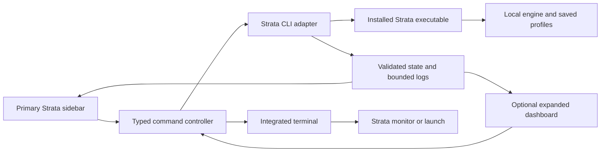

# Strata visual extension for VS Code and VSCodium

Status: implemented as a 0.1.0 preview on 2026-10-30. Source, build, VSIX packaging, graphical sidebar, shared dashboard, CLI integration, tests, and release workflows are present. See `docs/VALIDATION.md` for executed checks and outstanding acceptance work.

Implementation notes:

- The sidebar is the primary interface, with native profile/model/command trees and an optional expanded dashboard.
- Activity logs share the structured status snapshot instead of creating a second polling process; the installed CLI log follower uses the same feed internally.
- Starts, profile edits, and profile rollback recheck before execution because the tested public CLI lacks complete atomic preview guards for those actions. Runtime stop/restart/verify and source changes use available identity/revision guards.
- Detailed request/topology data is available as structured detail; full historical charts remain future scope.
- Real profile operations are validated in an isolated temporary directory. Live GPU serving, manual accessibility/TUI acceptance, additional operating systems, and registry publication remain release qualification tasks, not claimed completed.

## Objective

Build a desktop editor extension with its own Strata Activity Bar icon and dedicated sidebar panel as the primary interface. Present the information available in Strata's TUI as graphical status, metrics, logs, and controls, alongside command browsing and local engine management. Provide an optional expanded dashboard and access to the original terminal interfaces. VS Code and VSCodium must offer the same core functionality.

The first release targets an already installed Strata CLI and engine on Linux. Keep the extension portable, but qualify Windows and macOS only after testing against supported Strata installations. Initial scope is the engine on the editor's local machine. Remote engine administration, browser-only editors, and a new coding/chat assistant are outside the first release.

## Findings and assumptions

- This project directory has no application source yet.
- `/usr/bin/strata --version` reports Strata 0.2.8, build 0.1.54.
- The installed CLI exposes `runtime`, `profile`, `models`, `status`, `monitor`, `logs`, `doctor`, `components`, `engine`, `presets`, `launch`, and additional operator commands.
- `monitor` is a read-only TUI with seven views. `launch` provides guided setup and serving screens.
- Status, model listing, profiles, runtime operations, diagnostics, and calibration support structured output. Logs support JSONL following.
- Runtime processes can persist after their launching terminal closes. The extension should preserve that behavior unless the user explicitly stops the engine.
- Command syntax was checked using help, without changing the engine. JSON schemas, actual runtime behavior, and complete TUI view parity still need contract testing in phase 1.
- Treat 0.2.8/build 0.1.54 as the initial compatibility target, not a claim about the newest upstream release. Gate features by tested capabilities and fail clearly on unsupported output.

## User interface

Use a dedicated Strata view container opened from its Activity Bar icon. The sidebar is a complete working interface: users can monitor and operate the local engine while keeping their source file open. Use native tree views for model/profile lists and command navigation, with sidebar webview views for live metrics, forms, and log controls. An explicit “Expand Dashboard” action opens an optional editor tab for larger charts and detailed inspection. These are supported extension mechanisms: [Tree View API](https://code.visualstudio.com/api/extension-guides/tree-view) and [Webview API](https://code.visualstudio.com/api/extension-guides/webview).

```text
Strata sidebar (primary)           Source editor stays open
------------------------------    --------------------------------
Local machine | Profile selector   Your project files
Engine: Running | Active model
[Start] [Stop] [Restart]
Endpoint | Last updated
Performance
  Token speed | Memory | Requests
Models and profiles
  Select model/profile
  Settings | Preview | Apply
Logs
  Live activity | Search | Pause
Commands
  Runtime | Monitoring | Advanced
Diagnostics
[Expand Dashboard] [Open TUI]
```

1. **Live sidebar overview:** show selected profile, engine state, endpoint, model, last refresh, token speed, memory usage, and request activity wherever the CLI exposes those metrics. Explicitly distinguish stopped, starting, running, stopping, unreachable, and unknown states. Missing metrics appear as unavailable, never as zero.
2. **Engine controls:** start, drain/stop, restart, and explicitly requested verification. Show the target profile and any disruption in previews; verify state after completion.
3. **Profiles and models:** list installed model configs; inspect them; create/select profiles; edit supported typed overrides; validate and preview changes; distinguish saved settings from settings used by the running instance. Offer restart separately when needed.
4. **Command browser:** searchable categories, descriptions, arguments, examples, and a readable command preview. Common operations use forms. Advanced commands initially offer help and an explicit terminal launch. Label commands that download files, run workloads, or change the engine.
5. **TUI access:** open `strata monitor` in a named integrated terminal, preserving keyboard input, resizing, colors, and Ctrl+C. Separately expose `strata launch` for guided setup. Reuse a live matching terminal and recreate it after exit.
6. **Logs and diagnostics:** bounded log history, pause/follow controls, search, and an Output Channel for extension operations. Expose `doctor` results and actionable missing-CLI, permission, schema, and connection errors.
7. **Editor integration:** Command Palette actions, context menus, a compact status item, light/dark/high-contrast themes, keyboard navigation, and accessible labels. Support narrow sidebar widths with wrapping controls and collapsible sections. Preserve selected profile, filters, and section state across view recreation and editor reload.
8. **Optional expanded dashboard:** larger charts, detailed logs, and configuration comparisons share the sidebar's selected target and live state. Core monitoring, profile editing, and start/stop/restart must be usable without opening this tab or a terminal.

Populate graphical views from structured CLI output, independently of whether a terminal TUI is running. Do not scrape terminal text or embed terminal rendering as the primary panel. Inventory the seven monitor views during phase 1 and map each useful field to its structured source and sidebar section; document fields unavailable through supported interfaces. The first release must include graphical engine status, available performance metrics, model/profile selection, and live logs. Retain “Open TUI” as optional access to the complete original screens.

## Architecture

Use TypeScript for the extension host and webview, semantic HTML/CSS with editor theme variables, and a small bundled frontend without a required UI framework. Use stable public VS Code APIs, avoid native Node dependencies, and package one VSIX for both editors.



- **CLI adapter:** executable discovery, version/capability detection, argument construction, JSON validation, exit-code handling, timeouts, and output streaming. Execute with an executable path and argument array using `shell: false`.
- **Command registry:** typed metadata for supported commands, flags, capabilities, parameter validation, and whether an action reads, changes, downloads, or runs a workload. Do not turn arbitrary help text into executable actions automatically.
- **Engine service:** serialize conflicting operations per target; reconcile state after every mutation; reject stale completions after the user switches profiles. Let Strata remain responsible for engine ownership and configuration semantics.
- **View providers:** contribute a Strata Activity Bar view container, native trees, and `WebviewViewProvider` views for the graphical sidebar sections. Use an optional `WebviewPanel` for the expanded dashboard. Route both surfaces through the same command controller and state service; neither owns a separate engine session.
- **State service:** cache normalized snapshots, expose subscriptions, and bound retained data. Start with approximately two-second polling while either graphical surface is visible, a slower status refresh when both are hidden, no overlapping requests, and backoff when unreachable. Share polling and log subscriptions across views to avoid duplicate CLI processes. Restore disposed views from cached state and then refresh. Measure CLI startup cost before choosing final intervals.
- **Webview bridge:** typed, validated messages with request IDs; all process and credential access stays in the extension host. Use a restrictive CSP and locally bundled resources; render engine output as text.
- **Terminal service:** launch the executable directly with arguments where supported; never concatenate user input into shell commands. Verify that terminal execution occurs on the same local host as the adapter. Disable TUI launch in unsupported remote-window configurations rather than targeting a different machine silently.
- **Settings:** user/machine-scoped executable path, selected profile, refresh intervals, and optional local endpoint. Avoid assuming port 8080 when the runtime supplies an endpoint. Keep credentials in SecretStorage and pass them through a scoped child environment, not command arguments or logs.
- **Host placement:** declare a local UI extension (`extensionKind: ["ui"]`) and show the actual engine host. Validate local behavior in remote workspace windows; do not interpret remote workspace paths as local engine paths. See [extension host placement](https://code.visualstudio.com/api/advanced-topics/extension-host).
- **Trust:** use a trusted executable path and restrict workspace-provided execution settings; gate execution appropriately under Workspace Trust. See the [Workspace Trust guide](https://code.visualstudio.com/api/extension-guides/workspace-trust).

Suggested layout:

```text
src/
  extension.ts
  strata/          # CLI adapter, schemas, capabilities, command registry
  services/        # Runtime, profiles, models, telemetry, operations
  views/           # Sidebar view providers, trees, status item, expanded dashboard
  terminal/        # TUI launch and lifecycle
  shared/          # UI message contracts and normalized models
webview/           # Shared sidebar/dashboard components, forms, styles, accessibility
test/
  fixtures/        # Sanitized CLI output by supported version
  unit/           # Adapters and operation behavior
  integration/    # Editor and fake-CLI tests
docs/              # Command matrix and compatibility notes
```

## Initial CLI integration map

These command forms were confirmed in local help. Output schemas and semantic behavior remain to be validated.

| UI operation | CLI integration |
| --- | --- |
| Engine telemetry | `strata status --json` with explicit target options |
| Owned runtime state | `strata runtime status --profile <name> --json` |
| Start preview / start | `strata runtime start --profile <name> --plan --json`, then execute without `--plan` |
| Stop preview / stop | `strata runtime stop --profile <name> --plan --json`, then execute using returned owner/instance guards |
| Restart preview / restart | `strata runtime restart --profile <name> --plan --json`, then execute using applicable revision, owner, instance, and source guards |
| Profiles | `strata profile list --json`; `strata profile show <name> --effective --json` |
| Change settings | `strata profile set <name> <key=value> ... --plan --json`, then execute after review |
| Installed models | `strata models list --installed --json` |
| Request logs | `strata logs --follow --output jsonl` with explicit target options |
| Diagnostics | `strata doctor --json` |
| Original TUI | `strata monitor`; separately, `strata launch` |

Never infer that a reachable endpoint is owned by the selected profile. Before stop/restart, obtain the CLI plan, display its target, and pass its supported identity guards when executing. A stale guard requires a fresh preview. Do not kill arbitrary PIDs, hand-edit Strata's internal state files, or automatically enable source migration flags.

Cancellation must distinguish stopping the client process from stopping an engine operation. After timeout/cancellation, reconcile actual runtime state rather than reporting success or assuming rollback. Closing the editor leaves a background engine running; dispose polling and log follower processes on extension shutdown.

## Delivery phases and completion criteria

### 1. Establish Strata contracts

- Capture help and sanitized JSON fixtures for supported command paths, success, errors, no profiles, and unavailable engine states.
- Inventory monitor screens and map useful telemetry fields to structured CLI output and sidebar sections, recording unavailable fields and first-release coverage. Inspect profile validation, creation, model inspection, and verification subcommands before designing their forms.
- Define command capabilities and schema compatibility rules. Confirm preview guards, operation timeouts, cancellation semantics, and how the active endpoint is discovered.
- Deliver `docs/strata-command-matrix.md`, schema fixtures, and documented unsupported cases.

**Complete when:** every proposed first-release action maps to a verified command and typed output; unsupported actions have an explicit UI fallback. Real mutation checks use a designated test profile and disposable configuration.

### 2. Scaffold and prove editor compatibility

- Add the extension manifest, TypeScript build, lint/type checks, test harness, and VSIX packaging.
- Register the Strata Activity Bar icon and dedicated sidebar container, graphical sidebar view providers, native trees, commands, settings, and status item. Add an explicit action for the optional expanded dashboard.
- Implement executable discovery and a friendly setup view when Strata is missing.
- Inspect `shelly --help` before installing dependencies or building packages in this environment. Use Shelly for system package management; do not assume Arch tooling from repository packaging files.

**Complete when:** the same VSIX installs and activates in VS Code and VSCodium, identifies the installed CLI, and opens the Strata sidebar from its own icon while a source file remains open. The panel renders correctly at narrow and wide sidebar widths in both editors.

### 3. Ship a read-only vertical slice

- Implement runtime status, available performance metrics, models, profiles, diagnostics, bounded live logs, and reconnect behavior directly in the sidebar.
- Implement command browsing and integrated `monitor` TUI access.
- Add loading, empty, stale, unsupported-version, and unavailable-engine states.

**Complete when:** both editors show the real local engine and TUI-derived information in the dedicated sidebar without a terminal running, recover from the engine stopping, and retain state when views are hidden or recreated. Optional TUI access works, and merely opening views does not change engine configuration.

### 4. Add engine manipulation and profile editing

- Implement guarded start/stop/restart workflows and explicit runtime verification.
- Add profile creation, typed overrides, validation, change preview, saving, history/rollback where supported, and separate restart actions.
- Support selecting an installed model through the documented profile/run-config workflow; display whether that choice is saved or currently active.
- Add sidebar forms, action previews, progress tracking, conflict prevention, and reconciliation after failure or cancellation. Use native editor dialogs where appropriate while keeping the workflow independent of the expanded dashboard.

**Complete when:** a user can select a model/profile, start serving, edit settings, review and apply them, restart, and stop from the sidebar without opening a dashboard tab or terminal. Concurrent changes cannot silently target a replacement instance.

### 5. Complete command and TUI access

- Include every top-level command advertised by the installed supported version in the browser, with its actual supported action level: visual form, terminal workflow, or help only.
- Add guided `launch` access and reviewed terminal workflows for installation/update, calibration, presets, benchmarking, tuning, drafting, recipes, and other advanced commands.
- Re-detect capabilities after the executable/version changes. Do not install engine components or download models during activation.

**Complete when:** users can discover Strata's full command surface and open supported advanced workflows with accurate descriptions and command previews.

### 6. Validate and release

- Unit-test argument construction (including spaces/metacharacters), JSON decoding, stale operation results, identity guards, log bounds, and errors/timeouts.
- Use a fake CLI for integration tests: unavailable binary, malformed/partial output, delayed operations, changed owner, engine crash, rejected settings, and schema mismatch. CI should not require a GPU.
- Run editor integration tests and install the packaged VSIX into clean VS Code and VSCodium profiles. Exercise TUI resizing/input, lifecycle actions, themes, keyboard navigation, and reload behavior.
- Verify sidebar operation with a source file open, narrow widths, collapsed sections, focus changes, view recreation, and unavailable metrics. When the optional dashboard is open, verify synchronized target selection and updates without duplicate polling or log followers.
- Perform a real-engine acceptance run using a designated local test profile. Qualify supported OS/editor combinations explicitly; do not claim untested platforms.
- Document setup, minimum tested editor version, supported Strata versions, troubleshooting, and engine persistence.
- Produce a release VSIX and publishing workflows for Open VSX and Visual Studio Marketplace. Publishing requires configured publisher accounts and release credentials.

**Complete when:** the same release artifact passes the acceptance workflow in both editors, with reproducible packaging and documented compatibility. VSCodium uses Open VSX by default and also supports VSIX installation: [VSCodium extension documentation](https://raw.githubusercontent.com/VSCodium/vscodium/master/docs/extensions.md).

## Scope after the first release

Add graphical calibration reports, preset comparison, benchmark charts, installation/download progress, model migration, and broader TUI screen parity once their CLI contracts are verified. Remote monitoring can follow separately; remote mutation needs an explicit ownership and transport design. A new assistant/chat UI is a separate feature rather than a prerequisite for engine management.

## Principal implementation risks

| Risk | Planned response |
| --- | --- |
| CLI version or output changes | Versioned fixtures, schema validation, capability gates, actionable unsupported-version state |
| Saved configuration differs from running state | Display both; require an explicit restart to apply changes that need it |
| Another app or editor changes engine ownership | Refresh previews and execute with Strata's identity/revision guards |
| Polling costs or excessive logs | Measure overhead, prevent overlapping polls, back off, bound buffers, stop unused followers |
| Remote window launches commands on the wrong machine | Local host placement, explicit host label, verified terminal host or disablement |
| VS Code works but VSCodium does not | Stable APIs, no Microsoft-only dependencies, same-artifact acceptance testing, Open VSX distribution |

Implementation should begin with phases 1–3 as the first demonstrable milestone, followed by visual engine manipulation in phase 4. The complete first release includes phases 1–6.
